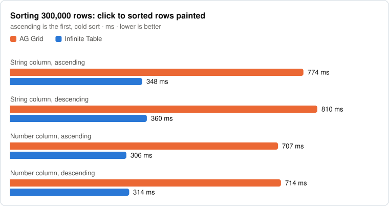
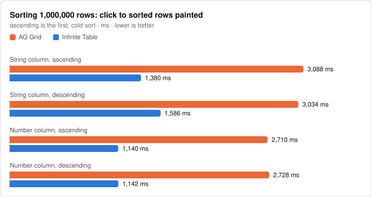

# Infinite Table vs AG Grid - performance comparison

A reproducible benchmark of two React DataGrids,
[Infinite Table](https://infinite-table.com) and
[AG Grid React](https://www.ag-grid.com/react-data-grid/) (Community), at
300,000 and 1,000,000 rows: mount time, memory, sorting and scrolling.

Both grids are installed from npm, render the same data in the same browser,
and get the same interactions. The benchmark runs again whenever a new version
of either grid is published, and the results below are updated - or you can
[run it yourself](#run-it), with any two versions.

The write-up, with the reasoning behind the methodology:
[Benchmarking Infinite Table and AG Grid with a million rows](https://infinite-table.com/blog/2026/11/11/benchmarking-infinite-table-and-ag-grid-with-a-million-rows).

We make Infinite Table, so read this with healthy suspicion - that is why the
whole thing is here for you to run.

<!-- results:start - generated by scripts/update-results.ts, do not edit by hand -->

## Results

**Infinite Table 10.1.4** vs **AG Grid React 36.3.0** - measured on 2026-11-11, on GitHub Actions, ubuntu-24.04 (AMD EPYC 9V45 96-Core Processor × 4), in Chrome 136.0.7103.25 (headless). Every value is the median of 7 runs.

The absolute numbers depend on the machine - compare the two grids, not the milliseconds. A difference is only called when the 95% confidence interval excludes "no difference".

<picture>
  <source media="(prefers-color-scheme: dark)" srcset="results/latest/charts/at-a-glance-dark.svg">
  
</picture>

<picture>
  <source media="(prefers-color-scheme: dark)" srcset="results/latest/charts/mount-dark.svg">
  
</picture>

<picture>
  <source media="(prefers-color-scheme: dark)" srcset="results/latest/charts/memory-dark.svg">
  
</picture>

<picture>
  <source media="(prefers-color-scheme: dark)" srcset="results/latest/charts/sort-300k-dark.svg">
  
</picture>

<picture>
  <source media="(prefers-color-scheme: dark)" srcset="results/latest/charts/sort-1m-dark.svg">
  
</picture>

<picture>
  <source media="(prefers-color-scheme: dark)" srcset="results/latest/charts/scroll-jump-dark.svg">
  
</picture>

<picture>
  <source media="(prefers-color-scheme: dark)" srcset="results/latest/charts/scroll-frames-dark.svg">
  
</picture>

<picture>
  <source media="(prefers-color-scheme: dark)" srcset="results/latest/charts/scroll-vertical-work-dark.svg">
  
</picture>

<picture>
  <source media="(prefers-color-scheme: dark)" srcset="results/latest/charts/scroll-horizontal-work-dark.svg">
  
</picture>

<details>
<summary>The same numbers, as a table</summary>

| | AG Grid | Infinite Table | Difference |
|---|---:|---:|---|
| Mount - First rows painted, 300k rows | 254 ms | 196 ms | **Infinite Table**: 23% lower |
| Mount - Settled (no more DOM changes), 300k rows | 356 ms | 196 ms | **Infinite Table**: 45% lower |
| Mount - First rows painted, 1M rows | 611 ms | 411 ms | **Infinite Table**: 33% lower |
| Mount - Settled, 1M rows | 714 ms | 411 ms | **Infinite Table**: 42% lower |
| Memory - 300k rows | 67.4 MB | 36.6 MB | **Infinite Table**: 46% lower |
| Memory - 1M rows | 213 MB | 90.7 MB | **Infinite Table**: 2.35× lower |
| Sort, 300k rows - String column, ascending | 732 ms | 353 ms | **Infinite Table**: 2.07× lower |
| Sort, 300k rows - String column, descending | 703 ms | 343 ms | **Infinite Table**: 2.05× lower |
| Sort, 300k rows - Number column, ascending | 628 ms | 288 ms | **Infinite Table**: 2.18× lower |
| Sort, 300k rows - Number column, descending | 632 ms | 287 ms | **Infinite Table**: 2.21× lower |
| Sort, 1M rows - String column, ascending | 3,088 ms | 1,380 ms | **Infinite Table**: 2.24× lower |
| Sort, 1M rows - String column, descending | 3,034 ms | 1,586 ms | **Infinite Table**: 48% lower |
| Sort, 1M rows - Number column, ascending | 2,710 ms | 1,140 ms | **Infinite Table**: 2.38× lower |
| Sort, 1M rows - Number column, descending | 2,728 ms | 1,142 ms | **Infinite Table**: 2.39× lower |
| Jump to rows painted - 300k rows | 28.4 ms | 28.4 ms | no significant difference |
| Jump to rows painted - 1M rows | 27.4 ms | 30 ms | **AG Grid**: 9% lower |
| Vertical scrolling, frames fully presented - 300k rows | 52% | 61.2% | **Infinite Table**: 9.16 points higher |
| Vertical scrolling, frames fully presented - 1M rows | 50.7% | 61.7% | **Infinite Table**: 11 points higher |
| Vertical scrolling, 300k rows, main-thread work - Scripting | 501 ms | 574 ms | **AG Grid**: 13% lower |
| Vertical scrolling, 300k rows, main-thread work - Layout | 86.9 ms | 66.4 ms | **Infinite Table**: 24% lower |
| Vertical scrolling, 300k rows, main-thread work - Style recalculation | 227 ms | 152 ms | **Infinite Table**: 33% lower |
| Vertical scrolling, 300k rows, main-thread work - All tasks | 1,288 ms | 1,298 ms | no significant difference |
| Horizontal scrolling, 300k rows, main-thread work - Scripting | 225 ms | 136 ms | **Infinite Table**: 40% lower |
| Horizontal scrolling, 300k rows, main-thread work - Layout | 66.6 ms | 10.9 ms | **Infinite Table**: 6.13× lower |
| Horizontal scrolling, 300k rows, main-thread work - Style recalculation | 39 ms | 42.5 ms | **AG Grid**: 8% lower |
| Horizontal scrolling, 300k rows, main-thread work - All tasks | 600 ms | 396 ms | **Infinite Table**: 34% lower |

</details>

Every metric of every scenario, with standard deviations and confidence intervals: [full report](./results/latest/report.md) · [raw samples](./results/latest/results.json).

## History

One row for every pair of versions measured so far, newest first. Each cell is **Infinite Table / AG Grid**; all are times in ms, except memory, in MB - lower is better. Rows measured on different machines can't be compared in absolute terms (hosted runners don't all have the same CPU) - compare how the two grids relate. The branch of a row has the code, the lockfile and the full results of that run.

| Infinite Table | AG Grid | Date | Mount 1M | Sort string 1M | Sort number 1M | Memory 1M | Vertical scroll work 300k | Horizontal scroll work 300k | Machine | Results |
|---|---|---|---:|---:|---:|---:|---:|---:|---|---|
| 10.1.4 | 36.3.0 | 2026-11-11 | 411 / 611 | 1,380 / 3,088 | 1,140 / 2,710 | 90.7 / 213 | 1,298 / 1,288 | 396 / 600 | GitHub Actions, ubuntu-24.04 · AMD EPYC 9V45 96-Core Processor × 4 | [branch](https://github.com/infinite-table/infinite-ag-grid-performance-comparison/tree/versions/infinite-10.1.4_ag-grid-36.3.0) |

<!-- results:end -->

## Run it

You need git and Node.js 20 or newer (we used 22). It runs on macOS and Linux.
Playwright downloads its own Chromium, so it doesn't matter which browser you
have installed.

```sh
git clone https://github.com/infinite-table/infinite-ag-grid-performance-comparison.git
cd infinite-ag-grid-performance-comparison
npm install
npx playwright install chromium

# production build, then every scenario at 300k and 1M rows
BENCH_HEADLESS=1 npm run benchmark
```

A full run takes about 25 minutes on an Apple M1 Pro: 9 scenarios × 2 sizes ×
2 grids × 8 runs. Without `BENCH_HEADLESS=1` it opens real browser windows -
closer to what users see, but you have to leave the machine alone while they
come and go.

For numbers you can trust, close other apps, keep a laptop plugged in, and
don't use the machine during the run.

To try it first, this takes about a minute:

```sh
npm run benchmark:build
# mount and string sorting, 300k rows only, 3 runs per grid
BENCH_HEADLESS=1 BENCH_SIZES=300k BENCH_SCENARIOS=mount,sort-string BENCH_RUNS=3 npm run benchmark:run
```

`npm run benchmark:run` reuses the last build. Build again after you change
the code or the installed versions.

### Results

Every run writes two files to `benchmark-results/<run id>/`:

- `report.md` - one table per scenario, with the median and standard deviation
  of each grid, the ratio between them, its 95% confidence interval, and which
  grid is better when the difference is significant
- `results.json` - every raw sample of every run

The most recent report is also copied to `benchmark-results/latest.md`.
`benchmark-results/` is git-ignored.

## Compare other versions

The versions that are measured are the ones installed in `node_modules`. The
report records them.

```sh
npm install @infinite-table/infinite-react@<version>
npm install ag-grid-community@<version> ag-grid-react@<version>

BENCH_HEADLESS=1 npm run benchmark
```

Keep `ag-grid-community` and `ag-grid-react` on the same version.

Infinite Table reaches the last of 1,000,000 rows starting with version
10.1.4. With older versions the setup of the 1M size fails, because the two
grids scroll over a different number of rows - use `BENCH_SIZES=300k` for
those.

## How the results above are kept up to date

The [Benchmark workflow](./.github/workflows/benchmark.yml) runs on GitHub
Actions:

- every 6 hours it looks on npm for a new version of
  `@infinite-table/infinite-react` or `ag-grid-react`. When there is one, it
  installs it, runs the whole benchmark and commits the results
- it can also be started by hand, for any pair of versions: Actions >
  Benchmark > Run workflow
- a `repository_dispatch` event of type `new-version` starts it right away,
  for a release pipeline that doesn't want to wait for the schedule

Where the results go:

- **`master`** always has the newest pair of versions: `package.json`,
  [`results/latest`](./results/latest) (the report and the raw samples) and
  the charts above
- **a branch for every pair of versions** that was measured -
  `versions/infinite-<version>_ag-grid-<version>` - with the code, the
  lockfile and the full results of that run
- **the [history](#history) table** on `master` has a row for every one of
  them, from [`results/history.json`](./results/history.json)

The hosted runners are shared virtual machines without a GPU, and their CPU
can change from one run to the next (the history table says which one it was).
So the absolute numbers differ between runs, and from the ones in the blog
post, which was measured on an Apple M1 Pro
([`results/blog-post-2026-11-11`](./results/blog-post-2026-11-11)). What the
benchmark is after is how the two grids relate - every run alternates between
them, so both get the same conditions.

If a run fails, the workflow opens an issue and stops trying that pair of
versions until the issue is closed.

To update the README from a run on your machine:
`node scripts/update-results.ts <run id>`.

## Look at the two grids

The pages the benchmark measures are ordinary pages you can open and scroll:

```sh
npm run benchmark:build
npm run benchmark:serve     # or: npm run dev
```

Then open [localhost:3000](http://localhost:3000) for the list:
`/benchmark/infinite-300k`, `/benchmark/infinite-1m`,
`/benchmark/ag-grid-300k` and `/benchmark/ag-grid-1m`. If port 3000 is taken,
pick another one with `npm run benchmark:serve -- -p 4000`.

## What is compared

Each grid is on its defaults. Only what makes the two layouts identical is
set:

- **Data:** 300,000 and 1,000,000 rows × 20 columns, generated
  deterministically ([`data.ts`](./src/benchmark/data.ts)). Both grids import
  the same module, and the setup checks a checksum and that both grids show
  the same text in the visible cells.
- **Same row height, header height and column widths.**
- **AG Grid:** the Quartz theme, all Community modules, `animateRows={false}`
  (Infinite Table doesn't animate rows on sort, and the animation would make
  "sorted rows visible" ambiguous) and a `getRowId` (Infinite Table always has
  a primary key). See [`AgGridBenchmark.tsx`](./src/benchmark/AgGridBenchmark.tsx).
- **Infinite Table:** see [`InfiniteBenchmark.tsx`](./src/benchmark/InfiniteBenchmark.tsx).
- **Each page loads only its own grid** - its code and its stylesheet.
- **The same body height.** The setup measures the scrolling body of both
  grids and makes the box of the shorter one taller until they match, so both
  render the same number of rows. See "License key" below for why this is
  needed.

### Scenarios

| Id                       |                                                                                            |
| ------------------------ | ------------------------------------------------------------------------------------------ |
| `mount`                  | mount the grid with all rows in memory: time to first rows painted, to settled, heap, DOM  |
| `sort-string`            | click a string column header - ascending (cold), then descending                           |
| `sort-number`            | the same, for a number column                                                              |
| `scroll-jump`            | ten programmatic jumps to far-away scroll positions                                        |
| `scroll-vertical`        | a wheel gesture down: frame rate, frame outcomes, main-thread work                         |
| `scroll-horizontal`      | wheel sweeps across all the columns                                                        |
| `correctness-vertical`   | during a very fast vertical scroll: is every cell there, and is it the right one?          |
| `correctness-horizontal` | the same, horizontally                                                                     |
| `visual-blank-vertical`  | a screencast of a very fast scroll: how many blank rows does the compositor actually show? |

## License key

AG Grid Community needs no license key. Infinite Table works without one too,
but shows a "Powered by Infinite Table" footer, which takes 24px from the
height of its body. Two things keep that from affecting the results:

- the setup makes the Infinite Table box taller, until the bodies of the two
  grids have the same height (the report says by how much)
- the footer sets its own inline styles again every second; the "settled"
  metric ignores those mutations, as it ignores screen-reader announcements

The results here were measured this way, without a license key - what you
get from a fresh clone. If you have a key, copy `.env.example` to `.env.local`
and set it there to measure the grid without the footer, then build again.

## Methodology

- **Production builds only.** The spec refuses a development build
  (`BENCH_ALLOW_DEV=1` to try it against `next dev` anyway).
- **Fresh browser context per run**, A/B interleaved: every scenario runs
  `BENCH_WARMUP` + `BENCH_RUNS` times per grid, alternating which grid goes
  first; warmup runs are discarded.
- **Latency from traces**, as in
  [js-framework-benchmark](https://github.com/krausest/js-framework-benchmark):
  from the input (pointerdown, `setState`, setting `scrollTop`) to the end of
  the first `Commit` after the DOM shows the expected content.
  - _visible_ - the first and last visible rows/columns show the right
    content, at the right place
  - _settled_ - the first frame committed after the grid's last DOM mutation.
    We don't use js-framework-benchmark's "last rAF/timer" rule, because grids
    schedule debounce timers that do no visible work.
- **Scrolling uses real input**: `Input.synthesizeScrollGesture` (Chrome's
  input pipeline, threaded scrolling), the same gesture for both grids.
  - frame outcomes from the compositor's `PipelineReporter` trace events:
    presented with the main-thread update, presented without it ("partial" -
    the compositor scrolled what it had), or dropped
  - rAF intervals and Long Animation Frames from the page
- **Correctness probe** (`correctness-*`): after every frame, samples points
  across the body and checks that the cell there is the one that should be
  there for the current scroll position - "blank" (no cell) or "wrong"
  (another row's content, or a cell lagging the scroll). It reads layout, so
  it runs in its own pass, never together with timing.
- **Screencast** (`visual-blank-vertical`): records what the compositor
  actually displays during a fast scroll and counts blank rows - this also
  catches the compositor scrolling ahead of the main thread.
- **Scroll range** (setup): browsers cap element sizes, and 1M rows × 40px is
  more than that. The setup scrolls each grid to the middle and to the end, to
  report whether the last row is reachable and how the scrollbar maps onto the
  rows. The probes and jumps use that mapping, so they measure rendering - not
  mapping differences.
- **Sandboxed Chromium**: the benchmark turns Chromium's sandbox on
  (Playwright turns it off by default), as in real Chrome. Without it, on
  macOS, the first hover recompute after a layout change under the mouse
  blocks the main thread for 30-80ms, once per page. It showed up as one long
  frame at the start of the first scroll - only for the grid that updates rows
  under the mouse first - and does not happen in a sandboxed renderer.
- **Fixed display scale**: Chromium runs with `--force-device-scale-factor=1`.
  The largest element a page can have depends on the scale factor of the
  display the window is on (about 33.5M px at 1x, 16.7M px at 2x), whatever
  the emulated `deviceScaleFactor`. Pinning it gives both grids the same limit
  on every machine; the setup fails if their scroll ranges differ.
- **Statistics**: medians, with a 95% bootstrap confidence interval of the
  ratio of medians (Infinite / AG Grid). A winner is only named when the
  interval excludes 1. When AG Grid has zeros among its values (0% blank
  samples, no long frames...), a ratio means nothing - the difference of
  medians (Infinite − AG Grid) is used instead, and its interval has to
  exclude 0.

Compare the grids, not the absolute numbers - they depend on the machine, and
the screencast in particular adds overhead.

## Options (env vars)

| Variable                                       | Default          |                                                                                              |
| ---------------------------------------------- | ---------------- | -------------------------------------------------------------------------------------------- |
| `BENCH_SIZES`                                  | `300k,1m`        | dataset sizes to run                                                                         |
| `BENCH_SCENARIOS`                              | all              | comma separated scenario ids, e.g. `mount,scroll-jump`                                       |
| `BENCH_RUNS` / `BENCH_WARMUP`                  | `7` / `1`        | measured / discarded runs per grid per scenario                                              |
| `BENCH_CPU_THROTTLE`                           | `1`              | CDP CPU throttling rate during measurements - `4` is closer to a mid-range laptop            |
| `BENCH_HEADLESS`                               | off              | `1` = Chromium's new headless mode (headed by default - closest to real vsync and GPU)       |
| `BENCH_NO_SANDBOX`                             | off              | `1` = run Chromium without its sandbox (where the sandbox can't start, e.g. some containers) |
| `BENCH_SCROLL_SPEED` / `BENCH_SCROLL_DISTANCE` | `8000` / `24000` | wheel gesture (px/s, px) for the smoothness scenarios                                        |
| `BENCH_FAST_SCROLL_SPEED`                      | `20000`          | the fast gesture of the correctness / screencast scenarios                                   |
| `BENCH_SAVE_TRACES`                            | off              | `1` = save every trace to `benchmark-results/<run id>/traces`                                |
| `BENCH_VERBOSE`                                | off              | `1` = log the last DOM mutations ("settled") and the first wrong samples of the probes       |
| `BENCH_RUN_ID`                                 | ISO date         | results folder name                                                                          |
| `BENCH_PORT` / `BENCH_BASE_URL`                | `5560` / -       | port of the server the config starts, or an already running server to use instead            |

## Files

| File                                                         |                                                                                       |
| ------------------------------------------------------------ | ------------------------------------------------------------------------------------- |
| `src/pages/benchmark/<grid>-<size>.tsx`                      | the four pages that are measured                                                      |
| `src/benchmark/data.ts`                                      | the deterministic dataset                                                             |
| `src/benchmark/AgGridBenchmark.tsx`, `InfiniteBenchmark.tsx` | each grid with its defaults + its DOM adapter                                         |
| `src/benchmark/BenchmarkPage.tsx`, `harness.ts`              | identical page shell; `window.__bench` - what the spec calls in the page              |
| `src/benchmark/grid-comparison.bench.ts`                     | the Playwright spec: scenarios, runs, report                                          |
| `src/benchmark/benchUtils.ts`                                | trace parsing, statistics, report                                                     |
| `playwright.config.ts`                                       | 1 worker, no retries, long timeouts, `next start` on port 5560                        |
| `next.config.js`                                             | Next.js is only the bundler and the server; it also reads the installed grid versions |
| `.github/workflows/benchmark.yml`                            | runs the benchmark for new versions and publishes the results                         |
| `scripts/check-versions.mjs`                                 | which versions to measure, and whether there is anything to do                        |
| `scripts/update-results.ts`                                  | a run -> `results/`, the charts and the results part of this README                   |

The files in `src/benchmark` are the same as the ones in the Infinite Table
repository, under
[`examples/src/benchmark`](https://github.com/infinite-table/infinite-react/tree/master/examples/src/benchmark),
where the benchmark runs against the grid's source instead of the npm package.

## Help us make it fairer

If you find a flaw in the methodology, a setting that unfairly favors one
grid, or a scenario that's missing, please
[open an issue](https://github.com/infinite-table/infinite-ag-grid-performance-comparison/issues)
or send a pull request. That goes double for the AG Grid team: if there's a
configuration you'd recommend for a fair comparison, we'll gladly add it and
run the numbers again.
