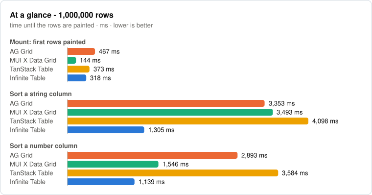
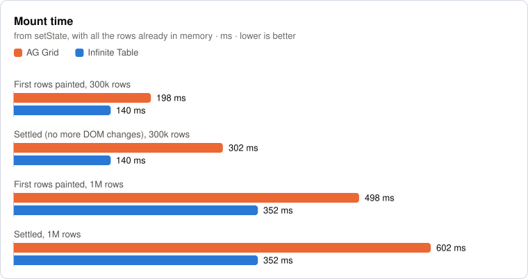
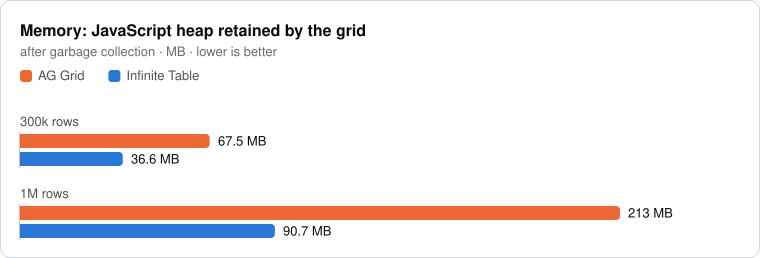
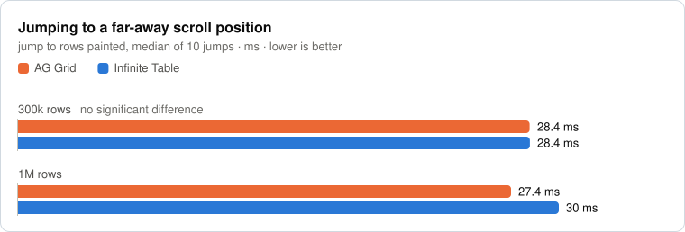
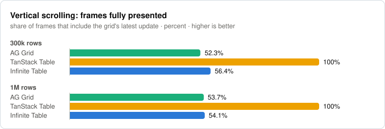
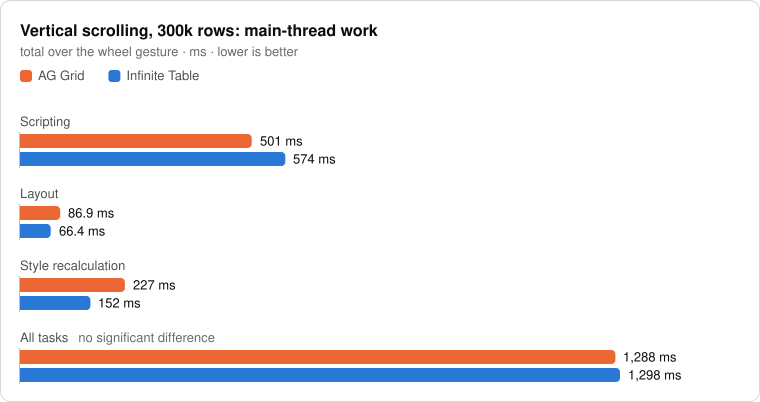
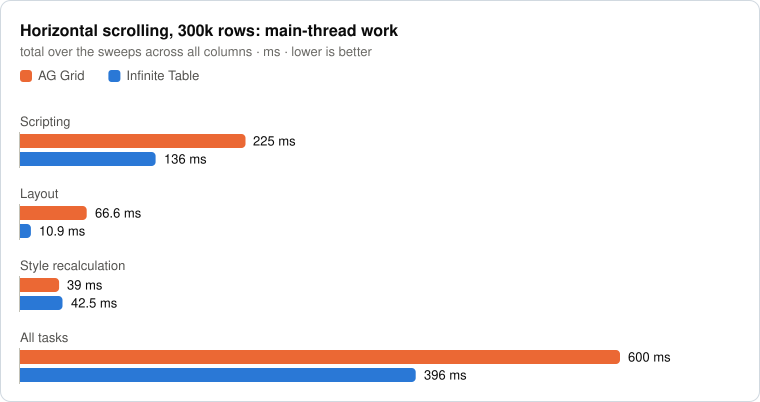

# DataGrid performance comparison: Infinite Table vs MUI X Data Grid, AG Grid and TanStack Table

A reproducible benchmark of four React DataGrids at 300,000 and 1,000,000
rows: mount time, memory, sorting and scrolling.

- [Infinite Table](https://infinite-table.com)
- [MUI X Data Grid](https://mui.com/x/react-data-grid/) (the free, MIT
  licensed `DataGrid`)
- [AG Grid React](https://www.ag-grid.com/react-data-grid/) (Community)
- [TanStack Table](https://tanstack.com/table), which is headless, rendered
  with [TanStack Virtual](https://tanstack.com/virtual) as in its official
  virtualization example

All of them are installed from npm, render the same data in the same browser,
and get the same interactions. The benchmark runs again whenever a new version
of Infinite Table or AG Grid is published, and the results below are updated -
or you can [run it yourself](#run-it), with any versions.

Two things to know before reading the numbers - both are explained in
[What is compared](#what-is-compared):

- **TanStack Table renders nothing by itself.** What is measured is TanStack
  Table plus TanStack Virtual plus the markup of the official example - a
  much smaller thing than a full grid, with no keyboard navigation, cell
  selection, column menus or pinned columns.
- **With 1,000,000 rows, MUI X Data Grid and TanStack Table can't scroll past
  row 838,860.** Infinite Table and AG Grid reach the last row.

The write-up, with the reasoning behind the methodology:
[Benchmarking Infinite Table, MUI X Data Grid, AG Grid and TanStack Table with a million rows](https://infinite-table.com/blog/2026/11/11/benchmarking-infinite-table-and-ag-grid-with-a-million-rows).

We make Infinite Table, so read this with healthy suspicion - that is why the
whole thing is here for you to run.

> **These results are being measured again.** The numbers below are from a run
> in which MUI X Data Grid showed one page of 100 rows, so it is missing from
> the scrolling charts and its mount and memory numbers are for that page. The
> setup described in this README - all the rows on one page - is being
> measured now, and its results will replace these.

<!-- results:start - generated by scripts/update-results.ts, do not edit by hand -->

## Results

**Infinite Table 10.1.5** vs **MUI X Data Grid 9.17.0** (the free `DataGrid`), **AG Grid React 36.3.0** (Community) and **TanStack Table 9.3.1** (with TanStack Virtual 3.14.26) - measured on 2026-11-12, on GitHub Actions, ubuntu-24.04 (AMD EPYC 9V74 80-Core Processor × 4), in Chrome 136.0.7103.25 (headless). Every value is the median of 7 runs.

The absolute numbers depend on the machine - compare the grids, not the milliseconds. In the table under the charts, a difference is only called when the 95% confidence interval excludes "no difference".

<picture>
  <source media="(prefers-color-scheme: dark)" srcset="results/latest/charts/at-a-glance-dark.svg">
  
</picture>

<picture>
  <source media="(prefers-color-scheme: dark)" srcset="results/latest/charts/mount-dark.svg">
  
</picture>

<picture>
  <source media="(prefers-color-scheme: dark)" srcset="results/latest/charts/memory-dark.svg">
  
</picture>

<picture>
  <source media="(prefers-color-scheme: dark)" srcset="results/latest/charts/sort-300k-dark.svg">
  
</picture>

<picture>
  <source media="(prefers-color-scheme: dark)" srcset="results/latest/charts/sort-1m-dark.svg">
  
</picture>

The string column is lowercase a-z text, sorted in an `en-US` browser. The grids do not compare strings the same way - see [String sorting](#string-sorting).

<picture>
  <source media="(prefers-color-scheme: dark)" srcset="results/latest/charts/scroll-jump-dark.svg">
  
</picture>

With 1M rows, MUI X Data Grid and TanStack Table (with TanStack Virtual) cannot scroll past row 838,860 - see [Scroll range](#scroll-range).

<picture>
  <source media="(prefers-color-scheme: dark)" srcset="results/latest/charts/scroll-frames-dark.svg">
  
</picture>

<picture>
  <source media="(prefers-color-scheme: dark)" srcset="results/latest/charts/scroll-vertical-work-dark.svg">
  
</picture>

<picture>
  <source media="(prefers-color-scheme: dark)" srcset="results/latest/charts/scroll-horizontal-work-dark.svg">
  
</picture>

<details>
<summary>The same numbers, as a table - and how Infinite Table compares with each grid</summary>

| | MUI X Data Grid | AG Grid | TanStack Table | Infinite Table | Infinite Table vs each grid |
|---|---:|---:|---:|---:|---|
| Mount - First rows painted, 300k rows | 275 ms | 323 ms | 232 ms | 246 ms | vs MUI X Data Grid: **Infinite Table** 11% lower<br>vs AG Grid: **Infinite Table** 24% lower<br>vs TanStack Table: **TanStack Table** 6% lower |
| Mount - Settled (no more DOM changes), 300k rows | 275 ms | 425 ms | 232 ms | 246 ms | vs MUI X Data Grid: **Infinite Table** 11% lower<br>vs AG Grid: **Infinite Table** 42% lower<br>vs TanStack Table: **TanStack Table** 6% lower |
| Mount - First rows painted, 1M rows | 745 ms | 808 ms | 659 ms | 565 ms | vs MUI X Data Grid: **Infinite Table** 24% lower<br>vs AG Grid: **Infinite Table** 30% lower<br>vs TanStack Table: **Infinite Table** 14% lower |
| Mount - Settled, 1M rows | 745 ms | 911 ms | 659 ms | 567 ms | vs MUI X Data Grid: **Infinite Table** 24% lower<br>vs AG Grid: **Infinite Table** 38% lower<br>vs TanStack Table: **Infinite Table** 14% lower |
| Memory - 300k rows | 53.9 MB | 67.4 MB | 86.6 MB | 36.6 MB | vs MUI X Data Grid: **Infinite Table** 32% lower<br>vs AG Grid: **Infinite Table** 46% lower<br>vs TanStack Table: **Infinite Table** 2.37× lower |
| Memory - 1M rows | 150 MB | 213 MB | 287 MB | 90.7 MB | vs MUI X Data Grid: **Infinite Table** 39% lower<br>vs AG Grid: **Infinite Table** 2.35× lower<br>vs TanStack Table: **Infinite Table** 3.16× lower |
| Sort, 300k rows - String column, ascending | 1,275 ms | 969 ms | 1,354 ms | 487 ms | vs MUI X Data Grid: **Infinite Table** 2.62× lower<br>vs AG Grid: **Infinite Table** 50% lower<br>vs TanStack Table: **Infinite Table** 2.78× lower |
| Sort, 300k rows - String column, descending | 1,205 ms | 1,008 ms | 1,354 ms | 571 ms | vs MUI X Data Grid: **Infinite Table** 2.11× lower<br>vs AG Grid: **Infinite Table** 43% lower<br>vs TanStack Table: **Infinite Table** 2.37× lower |
| Sort, 300k rows - Number column, ascending | 649 ms | 879 ms | 1,083 ms | 398 ms | vs MUI X Data Grid: **Infinite Table** 39% lower<br>vs AG Grid: **Infinite Table** 2.21× lower<br>vs TanStack Table: **Infinite Table** 2.72× lower |
| Sort, 300k rows - Number column, descending | 886 ms | 861 ms | 1,019 ms | 389 ms | vs MUI X Data Grid: **Infinite Table** 2.28× lower<br>vs AG Grid: **Infinite Table** 2.21× lower<br>vs TanStack Table: **Infinite Table** 2.62× lower |
| Sort, 1M rows - String column, ascending | 5,466 ms | 4,067 ms | 6,083 ms | 2,120 ms | vs MUI X Data Grid: **Infinite Table** 2.58× lower<br>vs AG Grid: **Infinite Table** 48% lower<br>vs TanStack Table: **Infinite Table** 2.87× lower |
| Sort, 1M rows - String column, descending | 5,478 ms | 4,141 ms | 5,848 ms | 2,431 ms | vs MUI X Data Grid: **Infinite Table** 2.25× lower<br>vs AG Grid: **Infinite Table** 41% lower<br>vs TanStack Table: **Infinite Table** 2.41× lower |
| Sort, 1M rows - Number column, ascending | 2,596 ms | 3,306 ms | 4,510 ms | 1,374 ms | vs MUI X Data Grid: **Infinite Table** 47% lower<br>vs AG Grid: **Infinite Table** 2.41× lower<br>vs TanStack Table: **Infinite Table** 3.28× lower |
| Sort, 1M rows - Number column, descending | 3,760 ms | 3,379 ms | 4,527 ms | 1,479 ms | vs MUI X Data Grid: **Infinite Table** 2.54× lower<br>vs AG Grid: **Infinite Table** 2.29× lower<br>vs TanStack Table: **Infinite Table** 3.06× lower |
| Jump to rows painted - 300k rows | 23.6 ms | 34.9 ms | 12.2 ms | 35.3 ms | vs MUI X Data Grid: **MUI X Data Grid** 33% lower<br>vs AG Grid: no significant difference<br>vs TanStack Table: **TanStack Table** 2.9× lower |
| Jump to rows painted - 1M rows | 21.8 ms | 34.9 ms | 12.5 ms | 40 ms | vs MUI X Data Grid: **MUI X Data Grid** 46% lower<br>vs AG Grid: **AG Grid** 13% lower<br>vs TanStack Table: **TanStack Table** 3.21× lower |
| Vertical scrolling, frames fully presented - 300k rows | 50.3% | 51.1% | 50.3% | 59.1% | vs MUI X Data Grid: **Infinite Table** 8.84 points higher<br>vs AG Grid: **Infinite Table** 7.99 points higher<br>vs TanStack Table: **Infinite Table** 8.84 points higher |
| Vertical scrolling, frames fully presented - 1M rows | 50.3% | 49.9% | 50.3% | 65.2% | vs MUI X Data Grid: **Infinite Table** 14.9 points higher<br>vs AG Grid: **Infinite Table** 15.3 points higher<br>vs TanStack Table: **Infinite Table** 14.9 points higher |
| Vertical scrolling, 300k rows, main-thread work - Scripting | 677 ms | 660 ms | 428 ms | 771 ms | vs MUI X Data Grid: **MUI X Data Grid** 12% lower<br>vs AG Grid: **AG Grid** 14% lower<br>vs TanStack Table: **TanStack Table** 44% lower |
| Vertical scrolling, 300k rows, main-thread work - Layout | 72 ms | 111 ms | 92.1 ms | 87.8 ms | vs MUI X Data Grid: **MUI X Data Grid** 18% lower<br>vs AG Grid: **Infinite Table** 21% lower<br>vs TanStack Table: **Infinite Table** 5% lower |
| Vertical scrolling, 300k rows, main-thread work - Style recalculation | 100 ms | 296 ms | 49.5 ms | 202 ms | vs MUI X Data Grid: **MUI X Data Grid** 2.02× lower<br>vs AG Grid: **Infinite Table** 32% lower<br>vs TanStack Table: **TanStack Table** 4.09× lower |
| Vertical scrolling, 300k rows, main-thread work - All tasks | 1,625 ms | 1,630 ms | 1,013 ms | 1,739 ms | vs MUI X Data Grid: **MUI X Data Grid** 7% lower<br>vs AG Grid: **AG Grid** 6% lower<br>vs TanStack Table: **TanStack Table** 42% lower |
| Horizontal scrolling, 300k rows, main-thread work - Scripting | 401 ms | 270 ms | 177 ms | 165 ms | vs MUI X Data Grid: **Infinite Table** 2.44× lower<br>vs AG Grid: **Infinite Table** 39% lower<br>vs TanStack Table: **Infinite Table** 7% lower |
| Horizontal scrolling, 300k rows, main-thread work - Layout | 49.1 ms | 78.9 ms | 54.6 ms | 11.9 ms | vs MUI X Data Grid: **Infinite Table** 4.14× lower<br>vs AG Grid: **Infinite Table** 6.65× lower<br>vs TanStack Table: **Infinite Table** 4.6× lower |
| Horizontal scrolling, 300k rows, main-thread work - Style recalculation | 24.5 ms | 46.7 ms | 15.7 ms | 53.4 ms | vs MUI X Data Grid: **MUI X Data Grid** 2.18× lower<br>vs AG Grid: **AG Grid** 13% lower<br>vs TanStack Table: **TanStack Table** 3.4× lower |
| Horizontal scrolling, 300k rows, main-thread work - All tasks | 749 ms | 721 ms | 538 ms | 495 ms | vs MUI X Data Grid: **Infinite Table** 34% lower<br>vs AG Grid: **Infinite Table** 31% lower<br>vs TanStack Table: **Infinite Table** 8% lower |

</details>

Every metric of every scenario, with standard deviations and confidence intervals: [full report](./results/latest/report.md) · [raw samples](./results/latest/results.json).

## History

Every set of versions measured so far, newest first, with a row for each grid. All the values are times in ms, except memory, in MB - lower is better. Runs measured on different machines can't be compared in absolute terms (hosted runners don't all have the same CPU) - compare how the grids relate within a run. The branch of a run has the code, the lockfile and the full results of that run.

| Run | Grid | Mount 1M | Sort string 1M | Sort number 1M | Memory 1M | Vertical scroll work 300k | Horizontal scroll work 300k |
|---|---|---:|---:|---:|---:|---:|---:|
| 2026-11-12<br>GitHub Actions, ubuntu-24.04 · AMD EPYC 9V74 80-Core Processor × 4<br>[branch](https://github.com/infinite-table/datagrid-performance-comparison/tree/versions/infinite-10.1.5_mui-9.17.0_ag-grid-36.3.0_tanstack-9.3.1) | Infinite Table 10.1.5 | 565 | 2,120 | 1,374 | 90.7 | 1,739 | 495 |
|  | MUI X Data Grid 9.17.0 | 745 | 5,466 | 2,596 | 150 | 1,625 | 749 |
|  | AG Grid 36.3.0 | 808 | 4,067 | 3,306 | 213 | 1,630 | 721 |
|  | TanStack Table 9.3.1 | 659 | 6,083 | 4,510 | 287 | 1,013 | 538 |
| 2026-11-11<br>GitHub Actions, ubuntu-24.04 · AMD EPYC 9V45 96-Core Processor × 4<br>[branch](https://github.com/infinite-table/datagrid-performance-comparison/tree/versions/infinite-10.1.4_ag-grid-36.3.0) | Infinite Table 10.1.4 | 411 | 1,380 | 1,140 | 90.7 | 1,298 | 396 |
|  | AG Grid 36.3.0 | 611 | 3,088 | 2,710 | 213 | 1,288 | 600 |

<!-- results:end -->

## Run it

You need git and Node.js 20 or newer (we used 22). It runs on macOS and Linux.
Playwright downloads its own Chromium, so it doesn't matter which browser you
have installed.

```sh
git clone https://github.com/infinite-table/datagrid-performance-comparison.git
cd datagrid-performance-comparison
npm install
npx playwright install chromium

# production build, then every scenario at 300k and 1M rows
BENCH_HEADLESS=1 npm run benchmark
```

A full run takes about an hour on an Apple M1 Pro: 9 scenarios × 2 sizes ×
4 grids × 8 runs. Without `BENCH_HEADLESS=1` it opens real browser windows -
closer to what users see, but you have to leave the machine alone while they
come and go.

For numbers you can trust, close other apps, keep a laptop plugged in, and
don't use the machine during the run.

To try it first, this takes about a minute:

```sh
npm run benchmark:build
# mount and string sorting, 300k rows only, 3 runs per grid
BENCH_HEADLESS=1 BENCH_SIZES=300k BENCH_SCENARIOS=mount,sort-string BENCH_RUNS=3 npm run benchmark:run
```

`npm run benchmark:run` reuses the last build. Build again after you change
the code or the installed versions.

### Results

Every run writes two files to `benchmark-results/<run id>/`:

- `report.md` - one table per scenario, with the median and standard deviation
  of each grid and, for Infinite Table against each of the others, the ratio,
  its 95% confidence interval, and which grid is better when the difference is
  significant
- `results.json` - every raw sample of every run

The most recent report is also copied to `benchmark-results/latest.md`.
`benchmark-results/` is git-ignored.

## Compare other versions

The versions that are measured are the ones installed in `node_modules`. The
report records them.

```sh
npm install @infinite-table/infinite-react@<version>
npm install @mui/x-data-grid@<version>
npm install ag-grid-community@<version> ag-grid-react@<version>
npm install @tanstack/react-table@<version> @tanstack/react-virtual@<version>

BENCH_HEADLESS=1 npm run benchmark
```

Keep `ag-grid-community` and `ag-grid-react` on the same version.

To measure only some of the grids, name them: `BENCH_GRIDS=ag-grid,infinite`
(`mui`, `ag-grid`, `tanstack`, `infinite`).

Infinite Table reaches the last of 1,000,000 rows starting with version
10.1.4. Older versions stop before it, and the report says where - see
[Scroll range](#scroll-range).

## How the results above are kept up to date

The [Benchmark workflow](./.github/workflows/benchmark.yml) runs on GitHub
Actions:

- every 6 hours it looks on npm for a new version of
  `@infinite-table/infinite-react` or `ag-grid-react`. When there is one, it
  installs it, runs the whole benchmark and commits the results. MUI X Data
  Grid and TanStack Table stay on the versions in `package.json`
- it can also be started by hand, for any versions of the four: Actions >
  Benchmark > Run workflow
- a `repository_dispatch` event of type `new-version` starts it right away,
  for a release pipeline that doesn't want to wait for the schedule

Where the results go:

- **`master`** always has the newest versions: `package.json`,
  [`results/latest`](./results/latest) (the report and the raw samples) and
  the charts above
- **a branch for every set of versions** that was measured -
  `versions/infinite-<version>_mui-<version>_ag-grid-<version>_tanstack-<version>` -
  with the code, the lockfile and the full results of that run
- **the [history](#history) table** on `master` has the rows of every one of
  them, from [`results/history.json`](./results/history.json)

The hosted runners are shared virtual machines without a GPU, and their CPU
can change from one run to the next (the history table says which one it was).
So the absolute numbers differ between runs. What the benchmark is after is
how the grids relate - every run goes through all of them in turn, so they
get the same conditions.

If a run fails, the workflow opens an issue and stops trying those versions
until the issue is closed.

To update the README from a run on your machine:
`node scripts/update-results.ts <run id>`.

## Look at the grids

The pages the benchmark measures are ordinary pages you can open and scroll:

```sh
npm run benchmark:build
npm run benchmark:serve     # or: npm run dev
```

Then open [localhost:3000](http://localhost:3000) for the list - a page for
each grid and size: `/benchmark/<grid>-<size>`, where the grid is `infinite`, `mui`, `ag-grid`
or `tanstack` and the size is `300k` or `1m`. If port 3000 is taken,
pick another one with `npm run benchmark:serve -- -p 4000`.

## What is compared

Each grid is on its defaults. Only what makes the layouts identical is set:

- **Data:** 300,000 and 1,000,000 rows × 20 columns, generated
  deterministically ([`data.ts`](./src/benchmark/data.ts)). Every grid imports
  the same module, and the setup checks a checksum and that all the grids show
  the same text in the visible cells.
- **Same row height, header height and column widths.**
- **All the rows in one scrollable view.**
- **Each page loads only its own grid** - its code and its stylesheet.
- **The same body height.** The setup measures the scrolling body of every
  grid and makes the boxes of the shorter ones taller until they match, so
  all of them render the same number of rows. MUI's footer takes room from
  its body, and see "License key" below for Infinite Table. With 1M rows the
  bodies match to within a pixel: there, AG Grid's body only takes odd
  heights and MUI's only even ones.

What is set for each grid, and why:

- **Infinite Table:** nothing else. See
  [`InfiniteBenchmark.tsx`](./src/benchmark/InfiniteBenchmark.tsx).
- **MUI X Data Grid:** the free `DataGrid` from `@mui/x-data-grid`, with the
  default Material theme. See below, and
  [`MuiBenchmark.tsx`](./src/benchmark/MuiBenchmark.tsx).
- **AG Grid:** the Quartz theme, all Community modules, `animateRows={false}`
  (the other grids don't animate rows on sort, and the animation would make
  "sorted rows visible" ambiguous) and a `getRowId` (the other grids have a
  row id too). See [`AgGridBenchmark.tsx`](./src/benchmark/AgGridBenchmark.tsx).
- **TanStack Table:** see below, and
  [`TanStackBenchmark.tsx`](./src/benchmark/TanStackBenchmark.tsx).

### MUI X Data Grid: all the rows on one page

The free edition of MUI X Data Grid always paginates, and by default a page
has 100 rows. Two things are set, so it shows the same thing as the other
grids:

- **a page size of `-1`** - the value its
  [documentation](https://mui.com/x/react-data-grid/pagination/) gives for
  "all results". Every row is then on one page, which is virtualized and
  scrolled through like in the other grids. The pagination footer stays
  ("1–1,000,000 of 1,000,000").
- **number columns show the value as it is**, with a `valueFormatter` - by
  default MUI formats numbers for the locale ("100,000.13"), and the setup
  needs every grid to show the same text.

### TanStack Table: a headless library and our markup

TanStack Table has the row model and the sorting, and renders nothing. What
the benchmark measures is the combination its documentation recommends for
large tables: TanStack Table, [TanStack Virtual](https://tanstack.com/virtual)
for the rows and the columns, and plain `<table>` markup. The page follows the
official
[virtualized-columns example](https://github.com/TanStack/table/tree/main/examples/react/virtualized-columns),
with the same overscan (5 rows, 3 columns). What we changed:

- a fixed row height, so nothing is measured while scrolling (the example
  measures every row, for dynamic heights)
- no column resizing
- `sortDescFirst: false` - by default the first click on a number column
  sorts descending; in the other grids it sorts ascending
- `data-row-index` and `data-column-id` attributes on the cells, for the
  measuring code

Keep in mind what is being compared when you read its numbers. The other
three are full grids: keyboard navigation, focus, cell and row selection,
column menus, resizing, reordering and pinning, accessibility attributes on
every cell. This page has none of that, and renders far fewer DOM
elements - which is the point of a headless library, and it is also less work
on every frame.

### Scroll range

Browsers cap the size of an element (about 33.5M px in Chrome), and 1,000,000
rows × 40px is 40M px. A grid has to map its scrollbar onto the rows to show
all of them.

- **Infinite Table and AG Grid** do, and reach the last row.
- **MUI X Data Grid and TanStack Virtual** don't: the element is cut at the
  browser's limit, and the last row that can be scrolled to is 838,860. The
  161,140 rows after it are loaded and sorted, and can't be seen. Their 1M
  scrolling results are for the part that can be reached; and because their
  scrollbar is not stretched, the same wheel gesture goes over about 20%
  fewer rows than in the other two grids.

The report has these numbers for every run, under each size.

### Scenarios

| Id                       |                                                                                            |
| ------------------------ | ------------------------------------------------------------------------------------------ |
| `mount`                  | mount the grid with all rows in memory: time to first rows painted, to settled, heap, DOM  |
| `sort-string`            | click a string column header - ascending (cold), then descending                           |
| `sort-number`            | the same, for a number column                                                              |
| `scroll-jump`            | ten programmatic jumps to far-away scroll positions                                        |
| `scroll-vertical`        | a wheel gesture down: frame rate, frame outcomes, main-thread work                         |
| `scroll-horizontal`      | wheel sweeps across all the columns                                                        |
| `correctness-vertical`   | during a very fast vertical scroll: is every cell there, and is it the right one?          |
| `correctness-horizontal` | the same, horizontally                                                                     |
| `visual-blank-vertical`  | a screencast of a very fast scroll: how many blank rows does the compositor actually show? |

### String sorting

The string column is lowercase a-z text, and the browser runs as `en-US`. The
four grids don't compare strings the same way by default:

- **Infinite Table** uses the order of the browser's locale.
- **MUI X Data Grid** uses the order of the browser's locale too (an
  `Intl.Collator`).
- **AG Grid** compares character codes (`<`), which puts "Zebra" before
  "apple".
- **TanStack Table** picks its `text` sorting for this column: it compares the
  lowercased values by character code.

For lowercase a-z all four give the same order, which the benchmark checks.

Sorting a number column doesn't depend on any of this.

## License key

The free MUI X Data Grid, AG Grid Community and TanStack Table need no
license key. Infinite Table works without one too, but shows a "Powered by
Infinite Table" footer, which takes 24px from the height of its body. Two
things keep that from affecting the results:

- the setup makes the Infinite Table box taller, until the bodies of all the
  grids have the same height (the report says by how much)
- the footer sets its own inline styles again every second; the "settled"
  metric ignores those mutations, as it ignores screen-reader announcements

The results here were measured this way, without a license key - what you
get from a fresh clone. If you have a key, copy `.env.example` to `.env.local`
and set it there to measure the grid without the footer, then build again.

## Methodology

- **Production builds only.** The spec refuses a development build
  (`BENCH_ALLOW_DEV=1` to try it against `next dev` anyway).
- **Fresh browser context per run**, interleaved: every scenario runs
  `BENCH_WARMUP` + `BENCH_RUNS` times per grid, going through all the grids
  in each run and changing their order from one run to the next; warmup runs
  are discarded.
- **Latency from traces**, as in
  [js-framework-benchmark](https://github.com/krausest/js-framework-benchmark):
  from the input (pointerdown, `setState`, setting `scrollTop`) to the end of
  the first `Commit` after the DOM shows the expected content.
  - _visible_ - the first and last visible rows/columns show the right
    content, at the right place
  - _settled_ - the first frame committed after the grid's last DOM mutation.
    We don't use js-framework-benchmark's "last rAF/timer" rule, because grids
    schedule debounce timers that do no visible work.
- **Scrolling uses real input**: `Input.synthesizeScrollGesture` (Chrome's
  input pipeline, threaded scrolling), the same gesture for every grid.
  - frame outcomes from the compositor's `PipelineReporter` trace events:
    presented with the main-thread update, presented without it ("partial" -
    the compositor scrolled what it had), or dropped
  - rAF intervals and Long Animation Frames from the page
- **Correctness probe** (`correctness-*`): after every frame, samples points
  across the body and checks that the cell there is the one that should be
  there for the current scroll position - "blank" (no cell) or "wrong"
  (another row's content, or a cell lagging the scroll). It reads layout, so
  it runs in its own pass, never together with timing.
- **Screencast** (`visual-blank-vertical`): records what the compositor
  actually displays during a fast scroll and counts blank rows - this also
  catches the compositor scrolling ahead of the main thread.
- **Scroll range** (setup): browsers cap element sizes, and 1M rows × 40px is
  more than that. The setup scrolls each grid to the middle and to the end, to
  report whether the last row is reachable and how the scrollbar maps onto the
  rows. The probes and jumps use that mapping, so they measure rendering - not
  mapping differences. See [Scroll range](#scroll-range).
- **Sandboxed Chromium**: the benchmark turns Chromium's sandbox on
  (Playwright turns it off by default), as in real Chrome. Without it, on
  macOS, the first hover recompute after a layout change under the mouse
  blocks the main thread for 30-80ms, once per page. It showed up as one long
  frame at the start of the first scroll - only for the grid that updates rows
  under the mouse first - and does not happen in a sandboxed renderer.
- **Fixed display scale**: Chromium runs with `--force-device-scale-factor=1`.
  The largest element a page can have depends on the scale factor of the
  display the window is on (about 33.5M px at 1x, 16.7M px at 2x), whatever
  the emulated `deviceScaleFactor`. Pinning it gives every grid the same limit
  on every machine; the setup fails if the grids that reach their last row
  don't map the scrollbar the same way.
- **Statistics**: medians. Infinite Table is compared with each of the other
  grids: a 95% bootstrap confidence interval of the ratio of medians
  (Infinite / other), and a grid is only named as better when the interval
  excludes 1. When the other grid has zeros among its values (0% blank
  samples, no long frames...), a ratio means nothing - the difference of
  medians (Infinite − other) is used instead, and its interval has to exclude
  0. The other grids are not compared with each other.

Compare the grids, not the absolute numbers - they depend on the machine, and
the screencast in particular adds overhead.

## Options (env vars)

| Variable                                       | Default          |                                                                                              |
| ---------------------------------------------- | ---------------- | -------------------------------------------------------------------------------------------- |
| `BENCH_SIZES`                                  | `300k,1m`        | dataset sizes to run                                                                         |
| `BENCH_SCENARIOS`                              | all              | comma separated scenario ids, e.g. `mount,scroll-jump`                                       |
| `BENCH_GRIDS`                                  | all              | comma separated grids, at least two of `mui`, `ag-grid`, `tanstack`, `infinite`              |
| `BENCH_RUNS` / `BENCH_WARMUP`                  | `7` / `1`        | measured / discarded runs per grid per scenario                                              |
| `BENCH_CPU_THROTTLE`                           | `1`              | CDP CPU throttling rate during measurements - `4` is closer to a mid-range laptop            |
| `BENCH_HEADLESS`                               | off              | `1` = Chromium's new headless mode (headed by default - closest to real vsync and GPU)       |
| `BENCH_NO_SANDBOX`                             | off              | `1` = run Chromium without its sandbox (where the sandbox can't start, e.g. some containers) |
| `BENCH_SCROLL_SPEED` / `BENCH_SCROLL_DISTANCE` | `8000` / `24000` | wheel gesture (px/s, px) for the smoothness scenarios                                        |
| `BENCH_FAST_SCROLL_SPEED`                      | `20000`          | the fast gesture of the correctness / screencast scenarios                                   |
| `BENCH_SAVE_TRACES`                            | off              | `1` = save every trace to `benchmark-results/<run id>/traces`                                |
| `BENCH_VERBOSE`                                | off              | `1` = log the last DOM mutations ("settled") and the first wrong samples of the probes       |
| `BENCH_RUN_ID`                                 | ISO date         | results folder name                                                                          |
| `BENCH_PORT` / `BENCH_BASE_URL`                | `5560` / -       | port of the server the config starts, or an already running server to use instead            |

## Files

| File                                                         |                                                                                       |
| ------------------------------------------------------------ | ------------------------------------------------------------------------------------- |
| `src/pages/benchmark/<grid>-<size>.tsx`                      | the pages that are measured, one for each grid and size                               |
| `src/benchmark/data.ts`                                      | the deterministic dataset                                                             |
| `src/benchmark/<Grid>Benchmark.tsx`                          | each grid with its defaults + its DOM adapter (Infinite, MUI, AG Grid, TanStack)      |
| `src/benchmark/BenchmarkPage.tsx`, `harness.ts`              | identical page shell; `window.__bench` - what the spec calls in the page              |
| `src/benchmark/grid-comparison.bench.ts`                     | the Playwright spec: scenarios, runs, report                                          |
| `src/benchmark/benchUtils.ts`                                | trace parsing, statistics, report                                                     |
| `playwright.config.ts`                                       | 1 worker, no retries, long timeouts, `next start` on port 5560                        |
| `next.config.js`                                             | Next.js is only the bundler and the server; it also reads the installed grid versions |
| `.github/workflows/benchmark.yml`                            | runs the benchmark for new versions and publishes the results                         |
| `scripts/check-versions.mjs`                                 | which versions to measure, and whether there is anything to do                        |
| `scripts/update-results.ts`                                  | a run -> `results/`, the charts and the results part of this README                   |

The files in `src/benchmark` are the same as the ones in the Infinite Table
repository, under
[`examples/src/benchmark`](https://github.com/infinite-table/infinite-react/tree/master/examples/src/benchmark),
where the benchmark runs against the grid's source instead of the npm package.

## Help us make it fairer

If you find a flaw in the methodology, a setting that unfairly favors one
grid, or a scenario that's missing, please
[open an issue](https://github.com/infinite-table/datagrid-performance-comparison/issues)
or send a pull request. That goes double for the MUI X, AG Grid and TanStack
teams: if there's a configuration you'd recommend for a fair comparison - or a
better way to render TanStack Table - we'll gladly add it and run the numbers
again.
